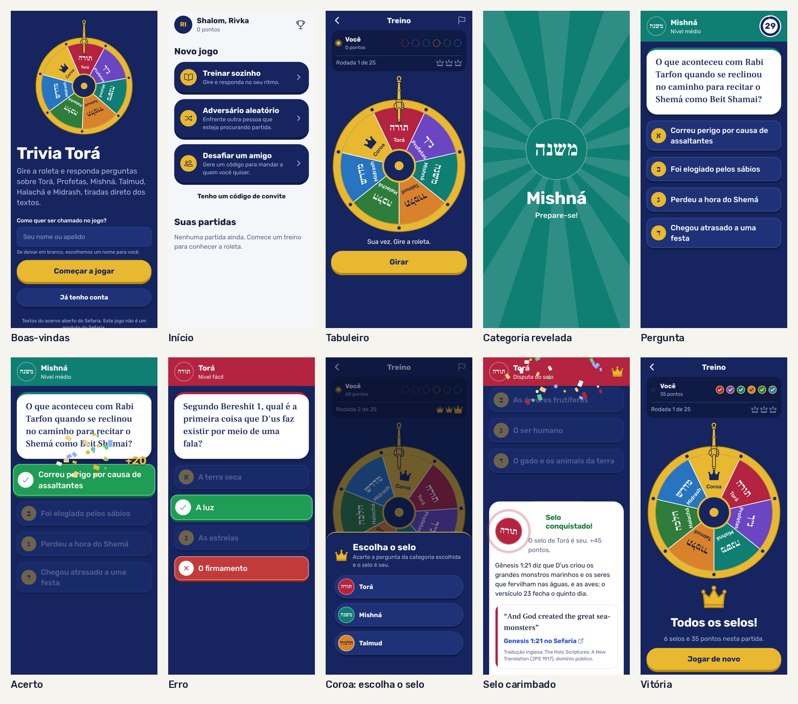
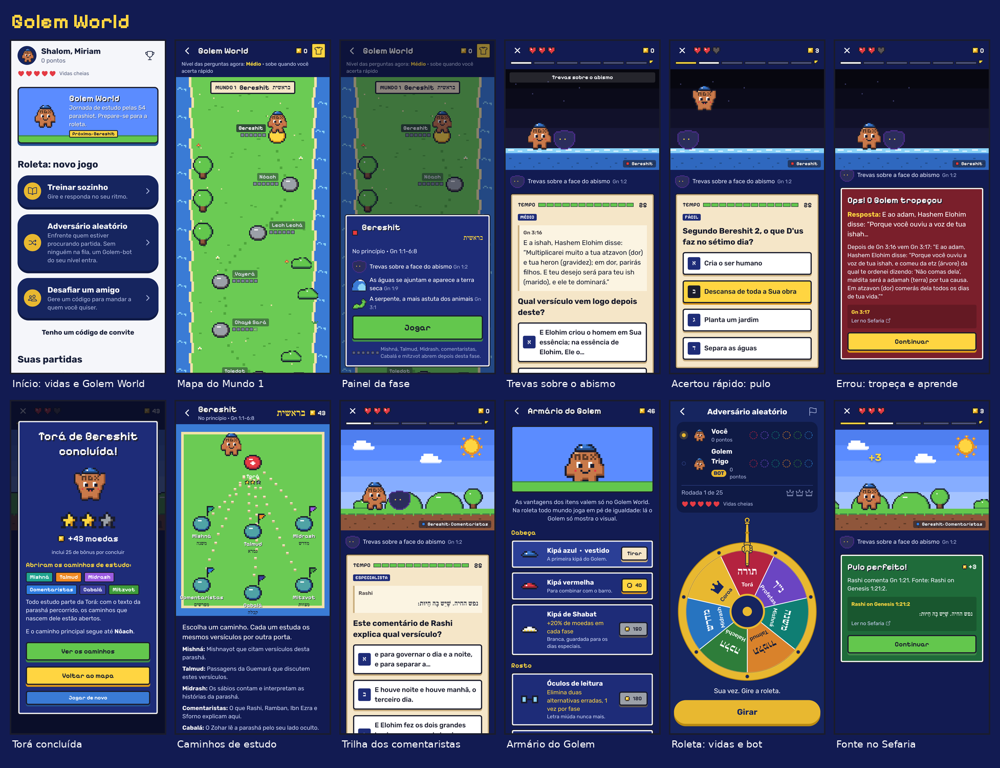
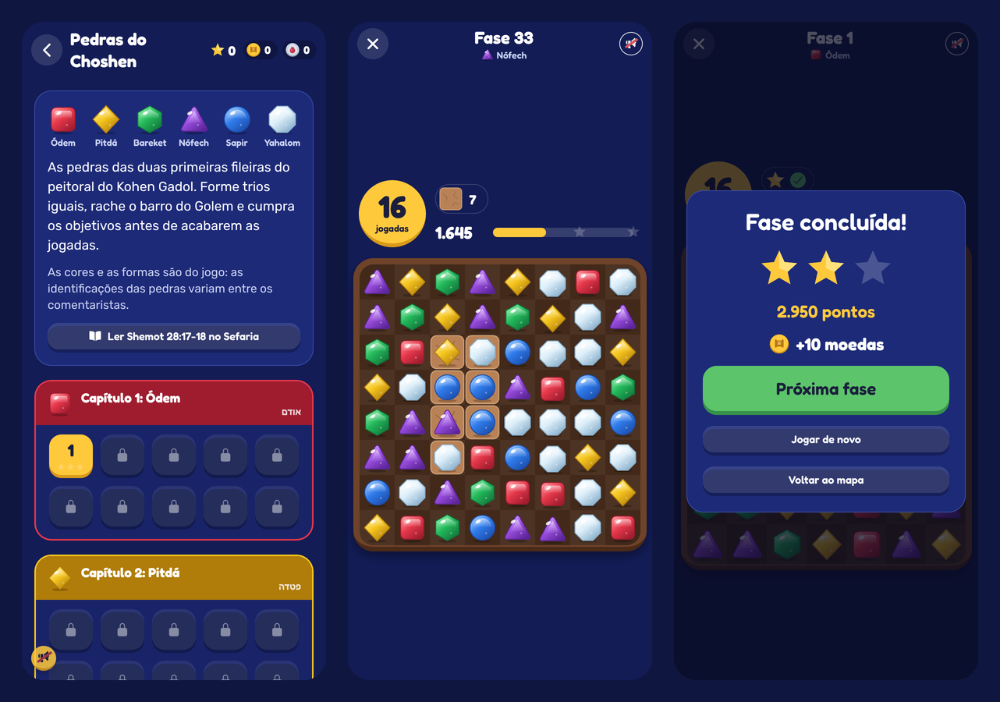
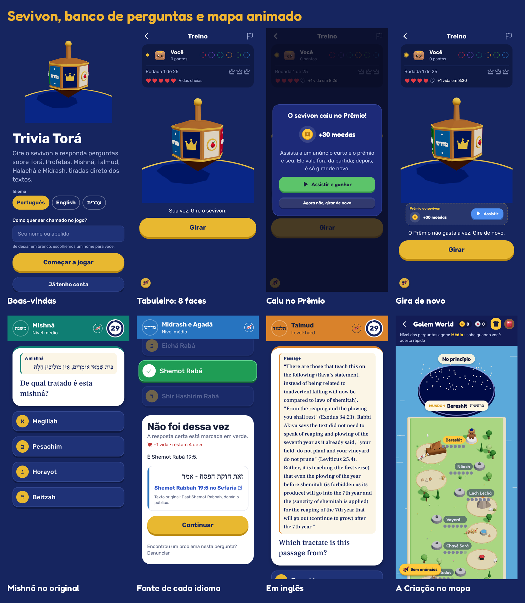
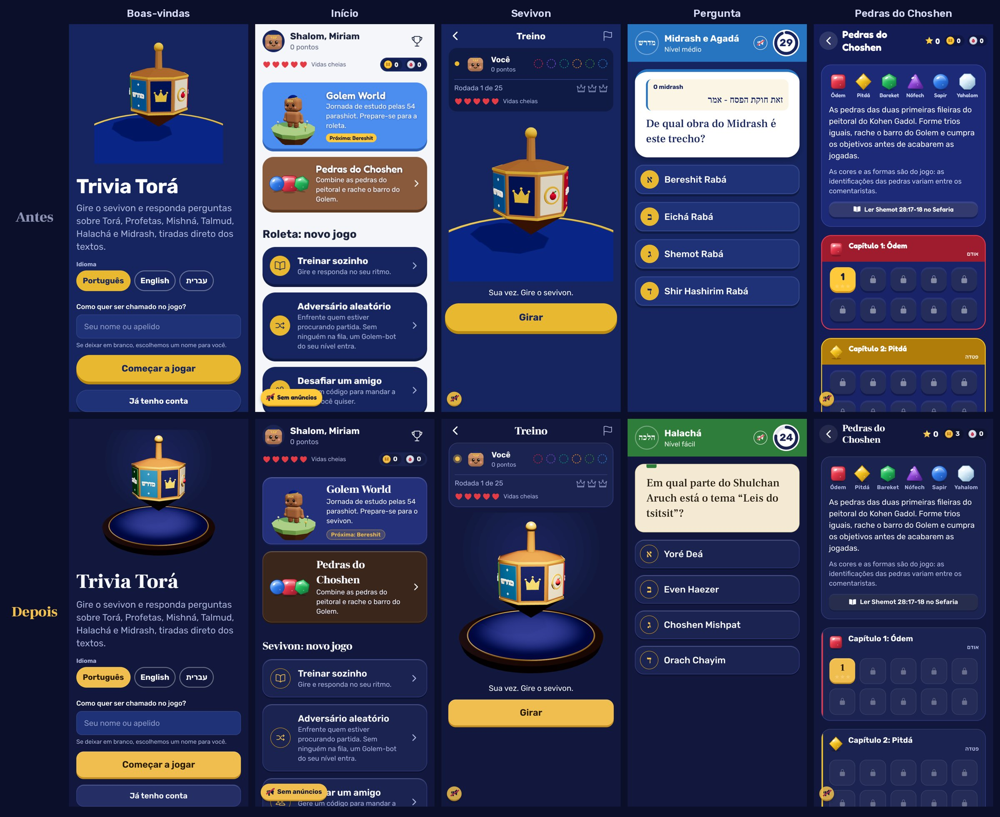
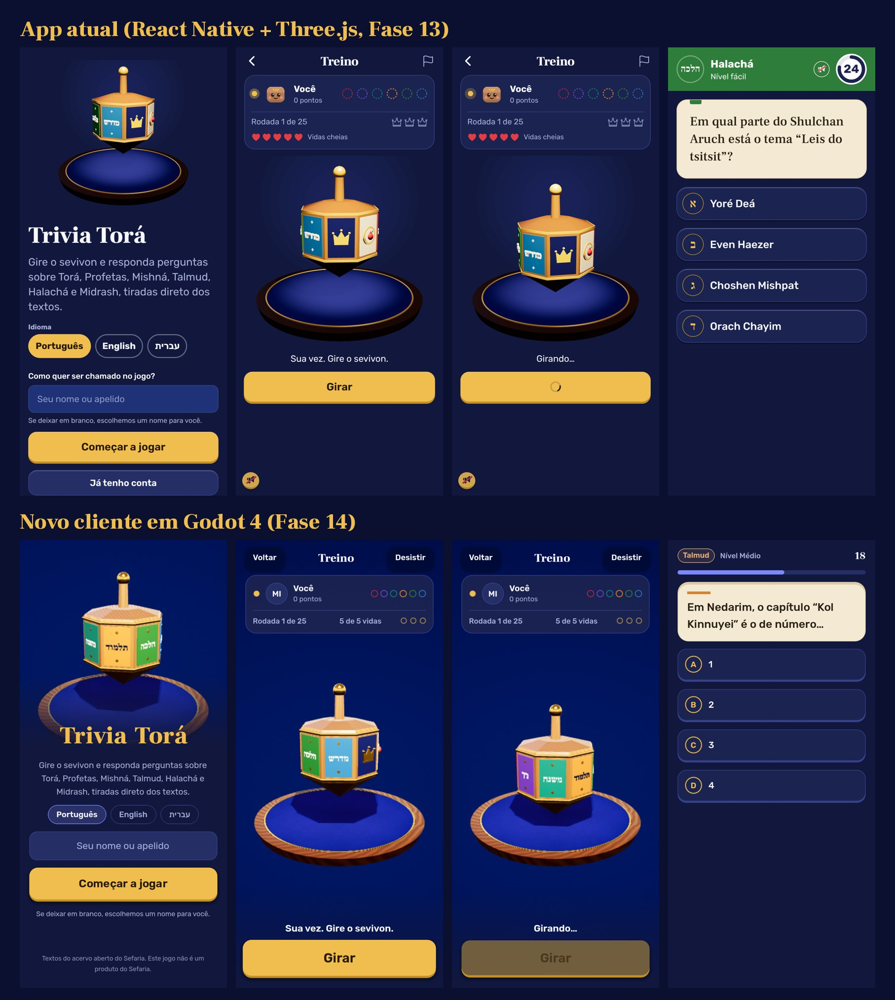

# trivia-torah

Quiz mobile no estilo Perguntados sobre Torá, Tanach, Mishná, Talmud, Halachá e Midrash, com três formas de jogar: o **sevivon** competitivo (contra amigos, outros jogadores ou um bot do seu nível, com ranking), o **Golem World**, uma jornada de estudo pelas 54 parashiot num mundo 3D de barro, com ilhas, cenários e um Golem que pula os obstáculos a cada resposta certa, e o **Pedras do Choshen**, um match-3 com as pedras do peitoral do Kohen Gadol. As perguntas nascem dos textos abertos do acervo Sefaria: um banco de mais de 7.500 perguntas já nos três idiomas, montadas por código a partir da estrutura e do texto do Sefaria e conferidas contra ele; perguntas montadas pelo jogo na hora; ou geradas por IA, verificadas por código e por um segundo modelo e aprovadas por revisão humana.

> Nome provisório. O projeto usa o Sefaria como fonte, mas não é um produto do Sefaria.













## Status

| Fase | Conteúdo | Situação |
|---|---|---|
| 1. Fundação | Monorepo, pacote `shared`, modelo de dados e migration, documentação | ✅ concluída |
| 2. Pipeline de IA | Download do Sefaria-Export, ingestão, prompts gerador e verificador, lotes, relatório de revisão, calibração | ✅ concluída |
| 3. API do jogo | Auth, roleta, turnos, correção no servidor, ranking, denúncias, revisão humana (página /admin) | ✅ concluída |
| 4. App mobile | Expo (iOS, Android e web): roleta com yad, quiz com cronômetro, fonte do Sefaria, ranking, perfil, convite | ✅ concluída |
| 5. Segurança | Limite de requisições, sessões revogáveis, política de senha, exclusão de conta, contas de revisor, denúncias à prova de abuso ([`docs/SECURITY.md`](docs/SECURITY.md)) | ✅ concluída |
| 6. Jogabilidade | Peças 3D, roleta com peso, revelação da categoria, cronômetro, confete, selo carimbado, sons ([`apps/mobile/README.md`](apps/mobile/README.md#movimento-e-som)) | ✅ concluída |
| 7. Golem World e competição | Mapa das 54 parashiot com caminhos de estudo que só abrem depois da Torá, fases com obstáculos e corações, dificuldade dinâmica, casas de estudo, armário com itens; perguntas montadas na hora a partir dos textos; vidas e bots na roleta ([`docs/GOLEM_WORLD.md`](docs/GOLEM_WORLD.md)) | ✅ concluída |
| 8. Idiomas e rede de casa | Português, inglês e hebraico (interface inteira da direita para a esquerda em hebraico); perguntas, alternativas e explicações sempre no idioma escolhido, com tradução automática do original quando o Sefaria não tem; `pnpm lan` abre o jogo no navegador do celular sem instalar nada | ✅ concluída |
| Visual novo | Golem World em 3D de barro (three.js), com cenários por parashá, obstáculos da própria história e mapa de ilhas; interface nova em Fredoka | ✅ concluída |
| 9. Economia e anúncios | Moedas de sabedoria (mérito) e shekels (comprados); personagens da história e visitantes, material do Golem, vidas e ajudas; compras conferidas com App Store e Google Play; anúncios com prêmio mostrado antes, prêmio da rodada, anúncio de pausa a cada 3 a 5 partidas e botão "Sem anúncios" ([`docs/ECONOMY.md`](docs/ECONOMY.md)) | ✅ concluída |
| 10. Login social | Google, Apple e Facebook; o convidado guarda o progresso com um toque; contas conectadas no perfil ([`docs/AUTH.md`](docs/AUTH.md)) | ✅ concluída |
| 11. Pedras do Choshen | Match-3 do Golem World com as pedras do peitoral (Shemot 28:17-18): 60 fases, especiais, barro, +5 jogadas com anúncio; o servidor refaz cada partida para conferir ([`docs/PUZZLE.md`](docs/PUZZLE.md)) | ✅ concluída |
| 12. Sevivon, banco e mapa animado | Sevivon 3D de 8 faces no lugar da roleta (as 6 categorias, a Coroa e o Prêmio com anúncio opcional); banco com mais de 1.000 perguntas por tema em português, inglês e hebraico, conferidas contra o Sefaria ([`docs/QUESTION_BANK.md`](docs/QUESTION_BANK.md)); as perguntas do Golem World também caem no sevivon; a Criação no topo do mapa e uma cena animada da parashá entre cada fase | ✅ concluída |
| 13. Visual e acertos | Visual novo no app inteiro ("tekhelet e klaf": noite azul-violeta, dourado só no que se ganha, pergaminho só no texto das fontes, títulos em Frank Ruhl Libre); sevivon numa mesa de nogueira sob luz quente, com o som do giro sincronizado; curva de dificuldade do Pedras do Choshen calibrada por simulação ([`docs/PUZZLE.md`](docs/PUZZLE.md#fases)); presente da pausa sem vida quando as vidas estão cheias | ✅ concluída |
| 14. Cliente em Godot 4 | Começo do cliente novo em Godot 4 ([`apps/godot`](apps/godot/README.md)), com as mesmas rotas da API: boas-vindas, início, partida solo e contra adversário aleatório, sevivon 3D com materiais físicos (madeira com veios, ouro refletindo um estúdio de luz), pergunta, resultado e fonte no Sefaria, nos três idiomas (hebraico espelhado). | ✅ concluída |
| 15. Golem World em Godot | No cliente Godot: o mapa das ilhas com o Golem andando pelo caminho, a ficha de cada fase, a fase jogável (diorama da parashá, os 30 obstáculos, poderes, corações, fonte no Sefaria, fim de fase) e a loja do Golem (armário, personagens e barro). As cenas animadas entre as fases e a Criação no topo do mapa | ✅ concluída |
| 16. Pedras do Choshen em Godot | No cliente Godot: o mapa das 60 fases, a partida com as pedras desenhadas, especiais, barro, cadeias e embaralhamento, o placar e o fim de fase conferido pelo servidor. O motor portado do TypeScript bate jogada por jogada com 775 jogadas gravadas | ✅ concluída |
| 17. Ranking e perfil em Godot | No cliente Godot: o ranking da semana e o geral; o perfil (nome, números do jogador, criar conta com e-mail e senha sem perder o progresso, idioma, sons, sair); entrar com e-mail e senha. | ✅ concluída |
| 18. Godot completo | No cliente Godot: a economia (anúncios com prêmio e compras de demonstração, presente da pausa, "Sem anúncios", abas Ajudas e Shekels na loja, Prêmio do sevivon, continuar e dobrar no Golem World, +5 jogadas), partida com amigo por código, conta e segurança, login social com Google e Facebook na web, denúncia de pergunta e a chanukiá de Chanucá. Anúncios reais, compras nas lojas e login com a Apple ficam para a exportação Android/iOS | ✅ concluída |
| 19. APK Android do Godot | `pnpm android:godot` no Windows gera o APK com o Android Studio (Godot baixado e conferido por SHA-512, SDK e Java do Android Studio, chave de depuração) e instala no celular; no jogo instalado, o endereço do servidor configurável, o Voltar do Android e a área segura da tela. Publicar na Play Store, AdMob e compras reais dependem das contas do Google | ✅ concluída |

## Estrutura

```
trivia-torah/
├── packages/shared/   tipos, schemas Zod, regras e checagens anti-alucinação
├── packages/db/       modelo de dados Prisma, migrations e client compartilhado
├── pipeline/          download, ingestão e geração de perguntas por IA
├── apps/api/          API do jogo (NestJS) e página de revisão /admin
├── apps/mobile/       app Expo (iOS, Android e web)
└── docs/              arquitetura, regras do jogo, política de conteúdo
```

## Pré-requisitos

- Node.js 26 LTS (recomendado, `.nvmrc`); 22.13 e 24 também funcionam
- pnpm 10 (`corepack enable` já instala a versão certa)
- Docker, para o PostgreSQL local

## Primeiros passos

```bash
corepack enable
pnpm install            # instala tudo e compila o pacote shared
pnpm secrets:init       # cria o .env a partir do .env.example, com segredos aleatórios
pnpm db:up              # sobe o PostgreSQL 16 no Docker (só acessível deste computador)
pnpm db:migrate         # aplica as migrations
pnpm db:generate        # gera o client do Prisma
pnpm test               # roda os testes
```

## Jogando pela primeira vez (sem chave de LLM)

O projeto traz 17 perguntas de demonstração, escritas à mão a partir de trechos reais de Gênesis, da Mishná Berachot e do Talmud Berachot. Assim dá para jogar antes de configurar o motor de IA:

```bash
pnpm pipeline seed-demo   # carrega as perguntas (aguardando revisão)
pnpm reviewers create --email voce@exemplo.com --name "Seu nome"   # sua conta de revisor; mostra a senha uma vez
pnpm api:dev              # API em http://localhost:3000
```

1. Abra http://localhost:3000/admin, entre com o e-mail e a senha do revisor, toque em "Selecionar todas desta página" e em "Aprovar selecionadas". (Para pular a revisão nas perguntas de demonstração: `pnpm pipeline seed-demo --approve`.)
2. Em outro terminal, rode `pnpm mobile` e leia o QR code com o app **Expo Go** no celular (mesma rede Wi-Fi do computador). Detalhes em [`apps/mobile/README.md`](apps/mobile/README.md).

Com as perguntas de demonstração, o sevivon tem Torá, Mishná, Talmud e a Coroa. Para as 6 categorias, carregue o banco de perguntas (abaixo). Para tirar as de demonstração depois: `pnpm pipeline seed-demo --remove`.

### Banco de perguntas (as 6 categorias, nos 3 idiomas)

O banco vem pronto no repositório (`pipeline/bank/*.jsonl`, mais de 7.500 perguntas). Para gravá-lo no PostgreSQL:

```bash
pnpm db:migrate
pnpm pipeline bank-import            # as escritas à mão entram aguardando revisão no /admin
pnpm pipeline bank-import --approve  # ou já aprovadas
```

Pode rodar de novo quando o banco mudar: só o que mudou é atualizado. Como o banco é montado e conferido está em [`docs/QUESTION_BANK.md`](docs/QUESTION_BANK.md).

### Jogando no celular pela rede de casa (sem instalar nada)

```bash
pnpm lan
```

Compila a API, gera a versão web do jogo e sobe as duas no mesmo endereço. O terminal mostra o link (algo como `http://192.168.0.12:3000`) e um QR code: com o celular no mesmo Wi-Fi, aponte a câmera e o jogo abre no navegador. "Adicionar à tela inicial" deixa ele com cara de app. Qualquer aparelho da rede pode jogar ao mesmo tempo. `pnpm lan --no-build` sobe de novo sem recompilar.

Se o celular não abrir a página:

- **Windows:** na primeira vez, o Firewall pergunta sobre o Node.js; marque **Redes privadas** e permita. A rede do Wi-Fi precisa estar como **Privada** (Configurações > Rede e Internet). Ou libere a porta no PowerShell como administrador: `New-NetFirewallRule -DisplayName "Trivia Tora (3000)" -Direction Inbound -Protocol TCP -LocalPort 3000 -Action Allow -Profile Private`.
- **Rede de visitantes ou de empresa:** algumas isolam os aparelhos entre si. Use a rede principal de casa ou o roteador do próprio celular.
- **"localhost" no celular** aponta para o próprio celular, por isso o link usa o IP do computador.

### Abrindo o Golem World

O Golem World monta as perguntas na hora a partir dos textos do Sefaria (sem chave de LLM), então primeiro é preciso carregar esses textos no banco. Precisa de internet; o download passa de 500 MB (as conexões do Sefaria são filtradas e os arquivos brutos, apagados) e leva alguns minutos:

```bash
pnpm db:migrate                  # aplica a migration da Fase 7, se o banco já existia
pnpm pipeline download --journey # Torá, comentaristas, Midrash Rabá, Zohar, Sefer HaChinuch, Mishná e Talmud ligados à Torá
pnpm pipeline journey-ingest     # grava os textos ligados a cada versículo e parashá
```

Sem esses textos, as fases aparecem no mapa como "em preparo". Detalhes em [`docs/GOLEM_WORLD.md`](docs/GOLEM_WORLD.md).

## Variáveis de ambiente

Todas estão documentadas em [`.env.example`](.env.example). O essencial:

| Variável | Usada por | Para quê |
|---|---|---|
| `DATABASE_URL` | api, pipeline | Conexão com o PostgreSQL |
| `JWT_ACCESS_SECRET`, `JWT_REFRESH_SECRET` | api | Assinatura dos tokens de login. Gerados por `pnpm secrets:init`; a API não sobe com os valores de exemplo |
| `NODE_ENV` | api | `development` no seu computador; qualquer outro valor liga as regras de produção |
| `CORS_ORIGINS` | api | Origens da versão web do app (em produção, só `https://`) |
| `TRUST_PROXY`, `HOST` | api | Proxy reverso na frente da API (para o limite de requisições ver o IP real) e a interface onde a API escuta |
| `RANKING_TIMEZONE` | api | Fuso do ranking semanal (padrão `America/Sao_Paulo`) |
| `BOTS_ENABLED` | api | Bot do nível do jogador no modo aleatório quando ninguém aparece em 8 s (padrão `true`) |
| `TRANSLATION_PROVIDER`, `TRANSLATION_MODEL` | api | Tradução automática do original para português e inglês quando o Sefaria não tem tradução aberta (`anthropic`, `off`) |
| `WEB_DIR` | api | Pasta da versão web servida pela própria API (`pnpm lan` define sozinho) |
| `ADS_MODE`, `STORE_MODE` | api | Anúncios (`admob`, `trust-client`, `demo`, `off`) e compras (`live`, `demo`, `off`). Em desenvolvimento, demonstração; em produção, só os de verdade |
| `APPLE_*`, `GOOGLE_PLAY_*` | api | Conferência das compras na App Store e no Google Play ([`docs/ECONOMY.md`](docs/ECONOMY.md#como-configurar)) |
| `GOOGLE_CLIENT_IDS`, `APPLE_SIGNIN_CLIENT_IDS`, `FACEBOOK_APP_*` | api | Login com Google, Apple e Facebook ([`docs/AUTH.md`](docs/AUTH.md#como-configurar)) |
| `LLM_PROVIDER` | pipeline | `anthropic` ou `openai` |
| `ANTHROPIC_API_KEY` / `OPENAI_API_KEY` | pipeline | Chave do motor de perguntas (só a do provedor escolhido) |
| `LLM_GENERATOR_MODEL`, `LLM_VERIFIER_MODEL` | pipeline | Modelos do gerador e do verificador |
| `SEFARIA_EXPORT_PATH` | pipeline | Pasta local onde o pipeline espelha o Sefaria-Export |
| `ALLOWED_LICENSES` | pipeline | Licenças de texto aceitas na ingestão |
| `SEFARIA_AUTHORIZED_VERSIONS` | pipeline | Versões liberadas pelo detentor dos direitos mesmo sem licença aberta |
| `QUESTION_NAME_STYLE` | pipeline | Grafia dos nomes: `portuguese` (Abraão) ou `transliterated` (Avraham) |
| `REQUIRE_HUMAN_REVIEW` | pipeline | `true` = nada entra no jogo sem aprovação |
| `EXPO_PUBLIC_API_URL` | mobile | Endereço da API; opcional em desenvolvimento, fica em `apps/mobile/.env` |

As chaves de LLM ficam só no ambiente do pipeline. Tudo com prefixo `EXPO_PUBLIC_` é embutido no app instalado, então ali só vão URLs públicas. A revisão humana não usa chave compartilhada: cada revisor tem a própria conta (`pnpm reviewers`).

## Documentação

- [Arquitetura e decisões](docs/ARCHITECTURE.md)
- [Regras do jogo](docs/GAME_RULES.md): sevivon, vidas, bots, ranking
- [Banco de perguntas](docs/QUESTION_BANK.md): como as 7.500 perguntas trilíngues são montadas a partir do Sefaria e conferidas
- [Golem World](docs/GOLEM_WORLD.md): mapa, fases, dificuldade dinâmica, itens, de onde vêm as perguntas
- [Economia e anúncios](docs/ECONOMY.md): as duas moedas, compras, anúncios com prêmio, "Sem anúncios", privacidade
- [Contas e login social](docs/AUTH.md): convidado, e-mail e senha, Google, Apple e Facebook; por que não há Instagram
- [Pedras do Choshen](docs/PUZZLE.md): o match-3 do Golem World, regras, fases e como o servidor confere cada partida
- [Política de conteúdo](docs/CONTENT_POLICY.md): fidelidade à fonte, respeito aos textos, Nomes Divinos, licenças
- [Segurança](docs/SECURITY.md): o que está protegido e como, checklist para publicar, riscos conhecidos

## Comandos

| Comando | O que faz |
|---|---|
| `pnpm secrets:init` | Cria o `.env` e gera os segredos que ainda estiverem com o valor de exemplo |
| `pnpm reviewers <comando>` | Contas da equipe: criar revisor, dar e tirar o papel, trocar apelido ofensivo, senha nova para quem perdeu (`help` lista) |
| `pnpm test` | Testes de todos os pacotes |
| `pnpm typecheck` | Checagem de tipos de todos os pacotes |
| `pnpm build` | Build de todos os pacotes |
| `pnpm db:up` / `pnpm db:down` | Sobe / derruba o Postgres local |
| `pnpm db:migrate` | Cria e aplica migrations em desenvolvimento |
| `pnpm db:deploy` | Aplica migrations em produção |
| `pnpm db:generate` | Gera o client do Prisma |
| `pnpm db:studio` | Abre o Prisma Studio |
| `pnpm pipeline <comando>` | Pipeline de perguntas (`help` lista os comandos) |
| `pnpm api:dev` / `pnpm api:start` | API em desenvolvimento (recarrega ao salvar) / servidor compilado (rode `pnpm build` antes) |
| `pnpm mobile` / `pnpm mobile:web` | App no Expo (QR code para o Expo Go) / no navegador |
| `pnpm lan` | O jogo no navegador de qualquer aparelho da rede de casa, com QR code (`--no-build` para não recompilar) |
