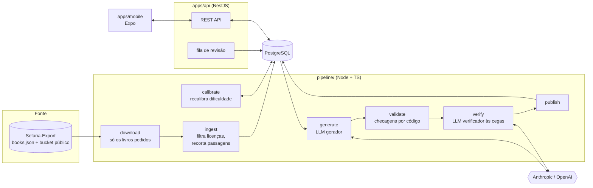
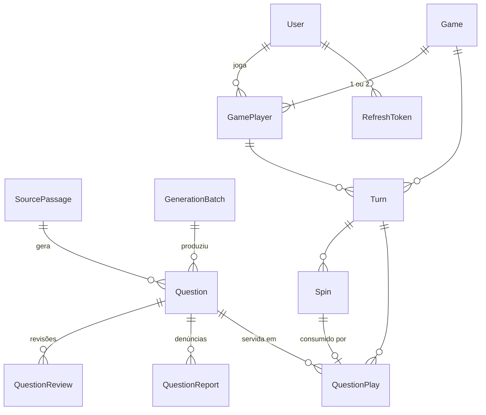
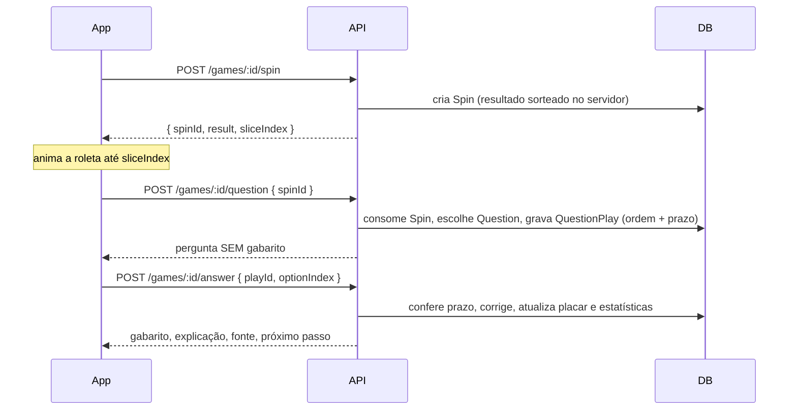

# Arquitetura

## Visão geral

O app mobile **nunca** fala com o LLM nem com o Sefaria: ele só conversa com a API. Chaves de LLM vivem apenas no ambiente do pipeline.

## Pacotes do monorepo

| Pacote | Papel | Estado |
|---|---|---|
| `packages/shared` | Tipos, schemas Zod, rubrica de dificuldade, mapeamento de categorias do Sefaria, normalização de hebraico, checagens anti-alucinação, contratos HTTP. Build ESM + CJS. | ✅ |
| `packages/db` | Schema Prisma, migrations (com restrições `CHECK`) e `createPrismaClient()`, compartilhados entre API e pipeline. | ✅ |
| `pipeline` | Download do Sefaria-Export, ingestão, geração, validação, verificação às cegas, lotes, relatório de revisão e calibração. | ✅ Fase 2 |
| `apps/api` | NestJS 12: auth (convidado, e-mail, refresh com rotação), partida, ranking, denúncias e revisão humana com página web em `/admin`. Limite de requisições, sessões revogáveis, exclusão de conta e contas de revisor (Fase 5, `docs/SECURITY.md`). | ✅ Fases 3 e 5 |
| `apps/mobile` | Expo SDK 58 + Expo Router: boas-vindas, início, tabuleiro com roleta, quiz, ranking, perfil e convite. Valida cada resposta da API com os schemas de `shared`. | ✅ Fase 4 |

## Decisões

**Pipeline em Node/TypeScript, não Python.** O schema da pergunta gerada (`GeneratedQuestionSchema`) é o mesmo objeto Zod que valida a saída do LLM, vira o JSON Schema enviado ao provedor (structured output) e tipa o que a API serve. Em Python seria preciso manter dois schemas em sincronia.

**Sefaria-Export em vez da API pública.** O Sefaria pede que coleta em massa use o export, não a API. Desde 2026 o export fica num bucket público do Google Cloud Storage (~26 GB); o repositório no GitHub guarda só o índice `books.json`. O comando `download` lê esse índice e baixa apenas os livros pedidos, espelhando a estrutura do bucket em `SEFARIA_EXPORT_PATH`.

**Versões individuais, nunca `merged`.** Cada versão de texto no Sefaria tem sua própria licença; os arquivos `merged` misturam versões e não trazem licença. O pipeline escolhe, por livro e idioma, a versão de licença menos restritiva entre as permitidas e guarda versão e licença em cada passagem.

**Idiomas alinhados por referência.** Todas as versões de um livro no Sefaria compartilham a mesma estrutura, então o segmento na posição [21][1] é "Genesis 22:2" em hebraico, inglês ou português. A ingestão junta os idiomas por essa posição e grava cada segmento com sua referência; a evidência de cada pergunta é conferida no segmento que ela cita.

**Servidor com autoridade total no jogo.** Giro, seleção de pergunta, embaralhamento, prazo e correção acontecem no servidor. Cada giro (`Spin`) só pode ser consumido uma vez e a pergunta chega ao app sem gabarito, o que fecha as trapaças óbvias (escolher categoria, ler a resposta no tráfego, responder depois do prazo).

**Duas camadas contra alucinação, uma por código e outra por modelo.**
1. Determinística (`validateGeneratedQuestion`): a citação de evidência tem que existir no texto-fonte; referência igual à da passagem; 4 alternativas distintas; sem coringas; política de Nomes Divinos.
2. Verificador às cegas (`evaluateVerifierResult`): outro modelo, vendo só o trecho e as alternativas embaralhadas, precisa chegar ao mesmo gabarito, com uma única alternativa defensável e confiança mínima.
3. Por cima das duas, revisão humana obrigatória enquanto `REQUIRE_HUMAN_REVIEW=true`.

**Dificuldade em duas etapas.** A IA dá o rótulo inicial com rubrica fechada; os dados de jogo recalibram (`recalibrateDifficulty`). O rótulo original fica em `Question.aiDifficulty`, o que permite medir o quanto a IA acerta a dificuldade e ajustar o prompt.

**NestJS 12 em ESM, com injeção explícita.** O NestJS 12 é distribuído só como ESM, então a API, o client Prisma (`moduleFormat = "esm"`) e o pipeline são todos ESM. Os construtores usam `@Inject(...)` explicitamente, para a injeção não depender de metadados de decorator: o mesmo código roda com `tsc`, `tsx` (desenvolvimento) e Vitest. O build CJS do `shared` existe para ferramentas que ainda pedem `require`.

**Roleta e cronômetro no app, decisão no servidor.** O app só anima a roleta até a fatia que a API sorteou (`sliceIndex`) e conta o tempo a partir da hora do servidor (`serverNow`), então nem um relógio errado no celular nem um cliente adulterado mudam o resultado.

**Prazos aplicados sob demanda.** Nenhuma tarefa agendada mexe em partidas em andamento: pergunta aberta além do tempo e vez parada por 48 h são resolvidas na próxima ação ou consulta da partida, dentro da mesma transação com trava. (A única tarefa periódica é a limpeza de tokens vencidos, convites parados há 7 dias e convidados sem uso.)

**Sessão conferida no banco a cada requisição.** O token de acesso leva a versão de sessão do usuário, e o guard confere conta, versão e papel no banco. Uma consulta por chave primária a mais por requisição compra revogação imediata: trocar a senha, "sair de todos os aparelhos", excluir a conta, tirar o papel de revisor ou detectar um refresh token vazado vale na hora, sem esperar o token de 15 minutos vencer. O papel nunca vem do token.

**Limite de requisições em duas camadas.** Um guard global limita por IP antes da autenticação (protege login e cadastro antes do custo do scrypt); um interceptor limita por conta depois dela. Os contadores ficam em memória, atrás de uma interface (`RateLimitStore`) que pode ir para o Redis quando houver mais de uma instância. Limites que precisam valer entre instâncias, como o de denúncias por dia, contam direto no banco. Detalhes e números em `docs/SECURITY.md`.

**Prisma 7 com driver adapter, num pacote próprio.** O Prisma 7 usa o driver `pg` via `@prisma/adapter-pg`. O schema e o client ficam em `packages/db` para que API e pipeline usem exatamente o mesmo modelo; a URL vem do `.env` da raiz.

**Prompts como arquivos versionados.** As regras do gerador e do verificador ficam em `pipeline/prompts/*.system.md`, com versão no cabeçalho. Cada lote grava a versão usada (`GenerationBatch.promptVersion`), e cada pergunta guarda o rótulo de dificuldade original da IA, o que permite comparar versões do prompt pelos resultados.

**Batch API para volume.** O modo `--batch` envia as passagens à Message Batches API da Anthropic (cerca de metade do custo, resultado em até 24 h) e o comando `collect` processa os resultados depois. O prompt de sistema vai marcado para cache, já que é idêntico em todas as chamadas.

## Modelo de dados

Além do que o Prisma modela, a migration inicial adiciona restrições `CHECK`: 4 alternativas por pergunta, gabarito entre 0 e 3, passagem com ao menos um idioma, assento 0 ou 1, Coroa entre 0 e 3, prazo posterior ao envio.

## Golem World e perguntas dinâmicas (Fase 7)

- `packages/shared/src/journey/`: catálogo das 54 parashiot (cenário, obstáculos com versículo, chegada), as trilhas, os itens e as regras puras (desbloqueio, corações, estrelas, moedas, dificuldade dinâmica). API e app usam as mesmas funções.
- `StudyText`: os textos de estudo de cada trilha, um registro por trecho (versículo, mishná, página da Guemará, comentário…), com os versículos a que se liga (`anchors`) e as parashiot (`parashot`). Mishná e Talmud entram pelas conexões do Sefaria. Gravados por `pnpm pipeline journey-ingest`.
- `QuestionFactory` (`apps/api/src/questions/`): para cada pedido (parashá × trilha × nível), serve uma pergunta aprovada inédita ou monta uma pergunta de molde na hora a partir de `StudyText` (sem IA). A roleta usa a mesma fábrica quando a categoria não tem pergunta inédita.
- `JourneyRun` / `JourneyAnswer` / `JourneyProgress` / `UserItem`: corrida de uma fase (corações, obstáculo atual, poderes restantes), cada pergunta servida (ordem das alternativas, prazo), o melhor resultado por fase e o armário. Como na roleta, o servidor decide tudo; a pergunta chega sem gabarito.
- Roleta: `User.lives`/`livesUpdatedAt` (vidas com recarga calculada na leitura, sem tarefa agendada), `User.isBot` e `BotService` (entra nas partidas aleatórias paradas e joga a vez dos bots).

Detalhes de jogo em [GOLEM_WORLD.md](GOLEM_WORLD.md) e [GAME_RULES.md](GAME_RULES.md).

## Fluxo de uma pergunta no jogo

