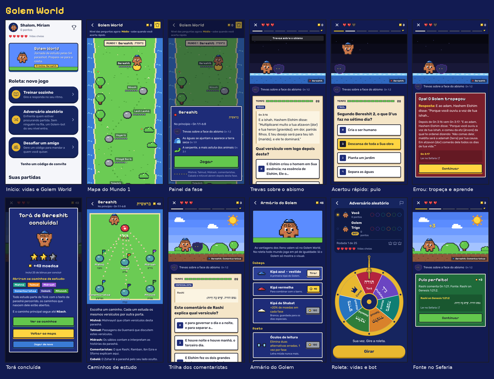

# Golem World

A jornada de estudo do jogo: um mapa no estilo dos jogos de plataforma de 16 bits,
em que o Golem percorre as 54 parashiot da Torá. Cada pedrinha da trilha é uma
fase; os obstáculos são vencidos respondendo perguntas. Não há ranking aqui: o
Golem World serve para aprender e chegar preparado ao sevivon (as perguntas das trilhas também caem nele).

**Cenas do mapa (Fase 12).** No topo do mapa, antes de Bereshit, a Criação acontece em loop: o vazio com estrelas, "haja luz", a terra subindo das águas, as árvores, o sol e a lua, as aves, os peixes e os bichos da terra. Entre uma fase e a seguinte, uma cena pequena conta a parashá que vem: a arca de Nôach com os bichos subindo, as estrelas de Lech Lechá, a escada de Yaakov, a sarça ardente, o mar aberto, o Sinai, o Mishkan, a jumenta de Bil'am e assim por diante (`apps/mobile/src/three/vignettes.ts`). Só o que está na tela se anima; com "reduzir movimento" ligado, as cenas ficam paradas.



As regras ficam em `packages/shared/src/journey/` (funções puras usadas pela API e
pelo app); a API está em `apps/api/src/journey/`; as telas em `apps/mobile/src/app/journey/`.

## O mapa

- **5 mundos**, um por livro da Torá (Bereshit, Shemot, Vayicrá, Bamidbar, Devarim),
  com as **54 parashiot** na ordem da leitura anual. As fronteiras de cada parashá
  seguem o índice "Parasha" do Sefaria.
- **Caminho principal = Torá.** Cada parashá tem uma fase sobre o próprio texto. A
  primeira (Bereshit) abre de início; cada uma abre a seguinte.
- **Caminhos de estudo (subcaminhos).** Concluir a Torá de uma parashá abre seis
  trilhas sobre ela: Mishná, Talmud, Midrash, Comentaristas (Rashi, Ramban, Ibn Ezra,
  Sforno), Cabalá (Zohar) e Mitzvot (Sefer HaChinuch). **Nenhuma trilha abre antes da
  Torá daquela parashá**: todo estudo parte do texto. O servidor impõe a regra
  (`prerequisitesOf` / `nodeState`); o app só a desenha.
- **Casa de estudos no fim de cada livro**, no lugar do castelo dos jogos de
  plataforma: a Yeshivá de Shem e Ever (Bereshit), a Tenda do Encontro (Shemot), a
  Casa de Estudos (Vayicrá), a Casa de Estudos do Deserto (Bamidbar) e a Sinagoga em
  Simchat Torá (Devarim). É uma fase de revisão do livro inteiro; vencê-la é um
  **siyum** ("Chazak, chazak venitchazek"), dá um item ao Golem e abre o livro seguinte.
- Como nos mapas de 16 bits: fase amarela = aberta, vermelha = concluída, cinza =
  fechada; as pedrinhas do caminho só aparecem por inteiro depois de percorridas.

## Uma fase

| | |
|---|---|
| Corações | 3 no início (itens podem somar até 6). |
| Obstáculos | 6 na Torá, 5 nas trilhas, 8 na casa de estudos. Cada um é uma pergunta. |
| Tempo | 25 s por pergunta (+ itens), com 3 s de tolerância de rede. |
| Acerto | Em até 35% do tempo: **pulo perfeito** (3 moedas). Até 75%: **passou** (2). Depois disso: **passou raspando** (1). |
| Erro ou tempo esgotado | O Golem tropeça, perde um coração e vem outra pergunta para o **mesmo** obstáculo. |
| Sem corações | A fase acaba; dá para tentar de novo na hora. |
| Estrelas | 3 sem perder coração, 2 perdendo um, 1 perdendo mais. |
| Conclusão | Bônus de moedas (Torá 15, trilha 10, casa de estudos 50, +5 por estrela); repetir uma fase rende metade. |

Os obstáculos e o cenário vêm da própria parashá (com o versículo de cada episódio):
em Bereshit o cenário acompanha os dias da Criação, das trevas sobre o abismo ao
sexto dia, e os obstáculos são as trevas, as águas, a serpente, os espinhos e a
espada flamejante; a chegada é o Shabat. Em Nôach, chuva, águas, a pomba e os
tijolos de Bavel, até o arco-íris. A Cabalá é jogada à noite, com estrelas.

Depois de cada resposta aparece o gabarito, a explicação e a **fonte no Sefaria**:
o objetivo é aprender.

### Dificuldade dinâmica

Cada jogador tem uma habilidade contínua de 0 (Fácil) a 3 (Especialista), que vale
para todas as fases. Pulo perfeito soma 0,6; passou, 0,3; raspando, 0,1; erro tira
0,5; tempo esgotado, 0,6. A próxima pergunta vem do nível mais próximo da
habilidade (`nextSkill`, `difficultyForSkill`). Resultado: quanto mais rápido você
acerta, mais difíceis ficam as perguntas; errando, elas ficam mais acessíveis.

## Moedas, itens e o armário

As moedas só compram itens; **não contam para nenhum ranking**. Os itens vestem o
Golem (um por espaço: cabeça, rosto, corpo, mão, companhia) e a maioria dá uma
vantagem **só no Golem World**. Na roleta o Golem aparece com o visual, mas ninguém
joga com vantagem.

| Item | Como ganhar | Vantagem |
|---|---|---|
| Kipá azul | inicial | — |
| Kipá vermelha | loja (40) | — |
| Kipá de Shabat | loja (150) | +20% de moedas |
| Óculos de leitura | loja (120) | elimina 2 alternativas erradas, 1×/fase |
| Lamparina | loja (180) | +6 s por pergunta |
| Sacola de livros | loja (220) | pula 1 pergunta/fase sem perder coração |
| Talit catan | casa de estudos de Bereshit | +1 coração |
| Pena do sofer | casa de estudos de Shemot | o primeiro erro da fase não custa coração |
| Chavruta | casa de estudos de Vayicrá | 2 dicas/fase (onde procurar a resposta) |
| Shofar | casa de estudos de Bamidbar | +1 coração |
| Bandeira de Simchat Torá | casa de estudos de Devarim | +50% de moedas |
| Lupa do comentarista | todas as trilhas de uma parashá | elimina 2 erradas, 2×/fase |

Desde a Fase 9 há duas moedas: as **moedas de sabedoria** (as de sempre, ganhas
estudando) e os **shekels** (comprados). Além dos equipamentos, o armário vende:

- **Personagens da história** (fantasias, como no Purim): Adão, Eva e a Serpente
  (Bereshit), Noé (Noach), Abraão (Lech Lechá), José (Vayêshev), Moisés (Shemot),
  Miriam (Beshalach) e Aarão (Tetsavê). Abrem depois de completar a Torá da parashá
  onde aparecem e custam moedas de sabedoria.
- **Visitantes** de fora da Torá: Davi, Ester, Mordecai e Jonas, com shekels.
- **Material do Golem** (só visual, com shekels): barro do Nilo, areia do deserto,
  pedra de Jerusalém, argila azul, cobre do Mishkan e cedro do Líbano.
- **Ajudas** para a mochila (+10 s, pular, eliminar 2), usadas quando a cota dos itens
  da fase acaba, e vidas da roleta.

Nada disso dá vantagem na roleta. Tudo em [`ECONOMY.md`](ECONOMY.md).

## De onde vêm as perguntas

As perguntas são **criadas pelo jogo, na hora**, nunca escritas à mão de antemão
(`apps/api/src/questions/question-factory.service.ts`). Para cada pergunta pedida
(parashá × trilha × nível), o servidor:

1. às vezes serve uma pergunta do motor de IA já aprovada para aquela parashá, que o
   jogador ainda não viu;
2. senão, **monta uma pergunta de molde** a partir dos textos do Sefaria guardados no
   banco (`StudyText`): completar o versículo, qual versículo vem depois, de que
   parashá é este versículo, que versículo esta mishná cita, de qual comentarista é
   este comentário, a que livro pertence esta passagem… Não há IA nesta etapa, então
   não há o que alucinar: a resposta certa é sempre um pedaço do próprio texto, e a
   fonte vai junto. Os Nomes Divinos nunca viram lacuna nem alternativa;
3. em último caso, repete uma pergunta já vista (melhor do que travar a fase).

A roleta usa a mesma fábrica quando a categoria sorteada não tem pergunta inédita
para o jogador.

Além disso, `pnpm pipeline journey-generate --watch 30` deixa o motor de IA rodando:
a cada intervalo ele procura as fases com menos perguntas, na ordem do mapa, e gera
perguntas de compreensão para elas (gerador + validação por código + verificador às
cegas, como no resto do pipeline). Com `REQUIRE_HUMAN_REVIEW=true` (padrão), essas
perguntas esperam aprovação no `/admin` antes de entrar no jogo.

### Carregando os textos

```bash
pnpm pipeline download --journey      # Torá, comentaristas, Midrash Rabá, Zohar, Sefer HaChinuch e as conexões do Sefaria
pnpm pipeline journey-ingest          # grava cada trecho ligado aos versículos e às parashiot
pnpm pipeline journey-generate --watch 30   # opcional: perguntas por IA (precisa de chave de LLM)
```

Mishná e Talmud entram pelas **conexões (links) do Sefaria**: uma mishná ou uma
página da Guemará vira texto da trilha de uma parashá quando o Sefaria a liga a um
versículo dela. Uma trilha sem textos aparece no mapa como "em preparo".

## Arte e som

- Mundo 3D **original** em polígonos baixos, com cara de diorama de massinha: luz
  quente, sombras suaves, cores de barro. O Golem é de barro, com אמת ("verdade") na
  testa, como na lenda, e veste os itens ganhos (kipá, óculos, tsitsit, lamparina…).
- Nada vem de arquivos de modelo ou de bancos de imagens: cada peça é montada em
  código com formas simples (`apps/mobile/src/three/`), o que mantém o app leve e
  permite testar no Node que todo obstáculo, marco e casa de estudos tem modelo.
- Cada parashá tem seu cenário e sua hora do dia (o abismo escuro do primeiro dia, o
  dilúvio, o deserto, o Egito), e cada pergunta é um obstáculo da própria história:
  a serpente, a arca, a escada de Yaakov, o bezerro de ouro.
- No mapa, as parashiot são ilhas ligadas por pedras que aparecem conforme o Golem
  avança; os nomes e os toques ficam em componentes comuns por cima do 3D, legíveis
  por leitores de tela.
- Títulos grandes e números de destaque em Frank Ruhl Libre Black; botões, textos e
  perguntas em Rubik (as duas com hebraico). A Fredoka saiu na Fase 13.
- Sons sintetizados (`scripts/make-sounds.py`): pulo, moeda, tropeço, pedrinhas do
  mapa, poder e fase concluída. Respeitam o modo silencioso e o interruptor "Sons do
  jogo".
- Com "reduzir movimento" ligado, o Golem fica parado, as ilhas não pulsam e as
  transições ficam instantâneas.
