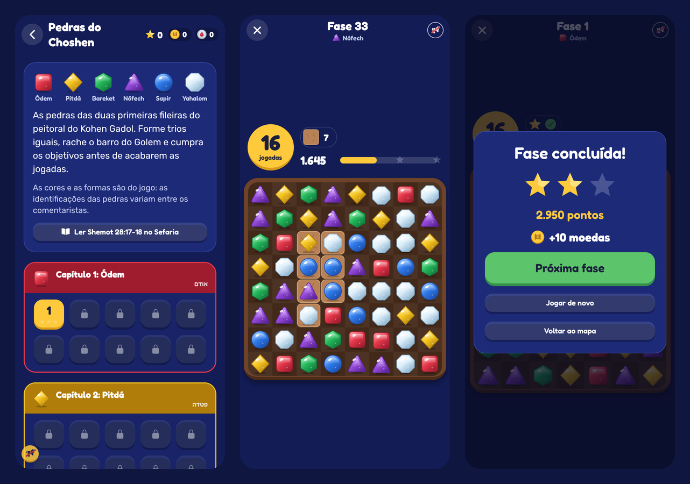

# Pedras do Choshen (Fase 11)

O match-3 do Golem World. As peças são as seis pedras das duas primeiras fileiras do peitoral do Kohen Gadol (Shemot 28:17-18): Ódem, Pitdá, Bareket, Nófech, Sapir e Yahalom. O barro do Golem aparece como obstáculo no tabuleiro.

## Respeito às fontes

- Nenhuma peça tem letra, texto ou Nome Divino. Elas são só pedras.
- As identificações das pedras variam entre os comentaristas. As cores e as formas são do jogo, e a tela do mapa diz isso.
- Cada pedra tem cor **e** forma próprias, para quem não distingue bem as cores.
- O mapa tem o link para Shemot 28:17-18 no Sefaria.

## Como se joga

- Troque duas pedras vizinhas (arrastando, ou tocando numa e depois na outra) para formar 3 ou mais iguais em linha ou coluna. Uma troca que não forma nada volta e não gasta jogada.
- 4 em linha formam o **Raio**, que limpa a linha (ou a coluna) onde foi formado.
- Um L ou T forma o **Estrondo**, que limpa o 3×3 em volta.
- 5 em linha formam o **Urim**. Trocado com uma pedra, ele limpa todas daquela cor.
- Dois especiais trocados entre si se combinam:

  | Combinação | Efeito |
  |---|---|
  | Raio + Raio | Limpa a cruz |
  | Estrondo + Estrondo | Limpa um 5×5 |
  | Raio + Estrondo | Limpa três linhas e três colunas |
  | Urim + especial | Todas as pedras daquela cor viram o especial e explodem |
  | Urim + Urim | Limpa o tabuleiro inteiro |

- Pedra limpa em cima de barro racha o barro, uma camada por vez.
- Combinações em cadeia valem mais: os pontos da cadeia são multiplicados (×2, ×3…).
- Sem jogada possível, o tabuleiro é embaralhado sem gastar jogada.
- Depois de 6 segundos parado, uma jogada possível pisca como dica.

### Objetivos

- Juntar pedras de uma cor.
- Rachar todo o barro.
- Fazer pontos.

Ao passar de fase, cada jogada que sobrou vale 50 pontos. As estrelas saem dos pontos: 1 estrela por passar e 2 ou 3 com mais pontos.

## Fases

São 60 fases fixas, em 6 capítulos de 10. Cada capítulo destaca uma pedra (`packages/shared/src/puzzle/levels.ts`). Cada fase tem duas partes.

**O desenho** (`puzzleLayout`) diz as cores, os tipos de objetivo e o barro. As novidades entram uma de cada vez:

- 4 cores nas fases 1 a 5, 5 cores até a 30 e 6 cores da 31 em diante;
- barro em formas fáceis (centro, xadrez, topo) no 1º capítulo; cruz e diagonais a partir do 2º;
- barro de duas camadas a partir do 4º capítulo, só no centro e no xadrez;
- as formas mais duras (base e cantos) só no fim do 2º e do 3º capítulos, com 5 cores. Com 6 cores elas pediam 40 a 55 jogadas, longas demais;
- cada capítulo abre com uma fase de pontos (um respiro) e fecha com barro e coleta juntos.

**O ajuste** (`PUZZLE_TUNING`) diz as jogadas e o tamanho dos objetivos. Ele foi calibrado por simulação (Fase 13) com dois robôs (`packages/shared/scripts/puzzle-bots.ts`):

- o **guloso** pega a melhor jogada imediata, como um bom jogador sem visão de futuro;
- o **casual** faz a jogada do guloso em metade das vezes e uma jogada qualquer na outra metade. É ele que define a curva.

A curva-alvo (`puzzleTarget`) é a proporção de partidas que o casual vence. Ela desce em linha reta de 99% na fase 1 até cerca de 50% na 60. A primeira fase de cada capítulo tem +5 pontos e a última −5.

Para cada fase, o casual joga 240 tabuleiros. Nas fases com coleta ou pontos, as jogadas ficam fixas (18 no 1º capítulo e 2 a mais por capítulo) e o objetivo cresce até a taxa de vitória bater na curva. Nas fases só de barro, o que se ajusta são as jogadas. Depois, os dois robôs conferem o resultado em outros 120 tabuleiros. A medição fica em `scripts/puzzle-curve.json`.

| Capítulo | Fases | Casual vence (média) | Guloso vence (pior fase) | Jogadas |
|---|---|---|---|---|
| 1 Ódem | 1–10 | 97% | 100% | 14–19 |
| 2 Pitdá | 11–20 | 90% | 98% | 14–33 |
| 3 Bareket | 21–30 | 83% | 94% | 16–29 |
| 4 Nófech | 31–40 | 74% | 82% | 24–32 |
| 5 Sapir | 41–50 | 63% | 88% | 22–30 |
| 6 Yahalom | 51–60 | 58% | 74% | 26–28 |

Antes da calibração, a curva tinha degraus. As fases 1 a 20 eram quase sempre vencidas (100% do casual). Na 21, com a 6ª cor, a taxa caía de uma vez para 70%. No barro duro com 6 cores (fases 36, 46, 50, 56), ela despencava para cerca de 30%, e logo depois vinham fases de 90%.

Mudou o desenho? Rode `pnpm --filter @trivia/shared calibrate-puzzle` (cerca de 10 minutos com 2 núcleos). O script reescreve a tabela e a medição. Os testes conferem três coisas:

- **`nenhuma fase é impossível`**: o guloso passa de todas;
- **`a dificuldade sobe aos poucos`**: a tabela bate com a medição, cada fase está a até 20 pontos da curva, não há tombo de mais de 20 pontos entre fases seguidas do mesmo capítulo e cada capítulo é mais difícil que o anterior;
- **`a medição confere`**: partidas novas do casual em seis fases batem com a curva.

Os robôs não são pessoas. A curva mede a dificuldade relativa entre as fases; o nível absoluto deve ser conferido com jogadores de verdade.

## Quem confere: o servidor

O motor (`packages/shared/src/puzzle/engine.ts`) é puro e determinístico. Ele usa um gerador de 32 bits (mulberry32) e só aritmética inteira. Com a mesma semente e as mesmas jogadas, o resultado é sempre igual, no celular e no servidor.

1. `POST /puzzle/runs` abre a partida e devolve a **semente**. Uma partida por vez: a anterior é deixada de lado. As fases abrem em ordem (`PUZZLE_LOCKED`).
2. O app joga sozinho, sem esperar a rede, e anima cada jogada a partir das etapas que o motor devolve: troca, estouro, queda e pedras novas.
3. `POST /puzzle/runs/:id/finish` recebe **todas as jogadas**. O servidor refaz a partida com o mesmo motor, e pontos, estrelas e moedas saem dessa reconstrução. Uma jogada que não vale no tabuleiro refeito, ou jogada depois do fim, recusa o envio (`PUZZLE_INVALID`). A partida fica travada (`FOR UPDATE`), então dois envios simultâneos não pagam duas vezes.
4. As moedas de sabedoria vêm **só pelas estrelas novas** de cada fase (5 por estrela). Repetir a fase não rende de novo. Elas entram no extrato com a chave `puzzle:<partida>`.

Quem lê o código do app pode calcular boas jogadas, porque a semente vai para o celular (é isso que deixa o jogo sem atraso). O prêmio é pequeno e limitado pelas estrelas, então isso não abre brecha na economia.

## Anúncio "+5 jogadas"

Quando as jogadas acabam, o jogo oferece +5 jogadas por um anúncio com prêmio (lugar `moves`, uma vez por partida, 15 por dia), pelo mesmo fluxo de oferta, confirmação e resgate dos outros prêmios ([ECONOMY.md](ECONOMY.md)). O prêmio grava `extraMoves` na partida, e o servidor só aceita as jogadas a mais quando ele foi resgatado. Fim de partida conta como pausa para o anúncio obrigatório.

## Arquivos

- Motor, fases, regras e contratos: `packages/shared/src/puzzle/`. Testes: `packages/shared/test/puzzle.test.ts`.
- Banco: `PuzzleRun` (`packages/db/prisma/migrations/20261105120000_puzzle`).
- API: `apps/api/src/puzzle/`. Testes: `apps/api/test/puzzle.e2e.test.ts`.
- App:
  - `src/lib/puzzle.ts` (a partida na tela) e `src/lib/puzzle-frames.ts` (quadros da animação, testados sem tela);
  - `src/components/puzzle/` (pedras em SVG, tabuleiro com gestos e animações, placar, fim de partida);
  - `src/app/puzzle/` (mapa e partida).
