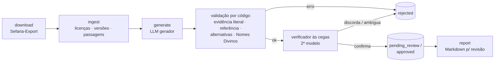

# pipeline

Transforma os textos do acervo Sefaria em perguntas de quiz: baixa os livros, recorta em passagens, gera perguntas com um LLM, confere cada uma por código e por um segundo modelo às cegas, e grava tudo no banco para revisão humana.



## Primeiras 20 perguntas (Bereshit 1–11)

Com o banco no ar (`pnpm db:up && pnpm db:migrate && pnpm db:generate`) e a chave do LLM no `.env`:

```bash
pnpm pipeline download --title Genesis        # alguns MB: só Gênesis, nas versões em he/en/pt
pnpm pipeline ingest --title Genesis          # ~320 passagens, nenhuma chamada ao LLM
pnpm pipeline generate --title Genesis --sections 1-11 --limit 10 --sync
pnpm pipeline report --title Genesis          # gera pipeline/out/review-<data>.md
```

Com `QUESTIONS_PER_PASSAGE=2`, 10 passagens rendem até 20 perguntas. O relatório mostra cada uma com o gabarito, a evidência, o link para o Sefaria, o veredito do verificador e o trecho de origem, incluindo as reprovadas e o motivo.

Para ver exatamente o que vai para o modelo antes de gastar tokens: `pnpm pipeline generate --title Genesis --limit 1 --dry-run` ([exemplo salvo](examples/generator-request.genesis-22.md)).

## Comandos

| Comando | O que faz |
|---|---|
| `download --title T` / `--category C` | Baixa do bucket público do Sefaria-Export só os livros pedidos (o export completo tem ~26 GB). `--force` baixa de novo; `--refresh-index` atualiza o `books.json`. |
| `ingest [--title] [--category] [--dry-run]` | Escolhe a melhor versão permitida de cada idioma, alinha os idiomas por referência, recorta em passagens e grava. Pode rodar de novo: só o que mudou é atualizado. |
| `generate [filtros] [--limit N] [--sync \| --batch] [--retry-failed] [--dry-run]` | Gera, valida, verifica e grava. Filtros: `--title`, `--category`, `--sections 1-11`. |
| `collect [--batch-id]` | Coleta lotes enviados com `--batch` que já terminaram. |
| `report [--status] [--title] [--batch-id] [--limit] [--out]` | Relatório Markdown para revisão. |
| `calibrate [--dry-run]` | Ajusta a dificuldade pelo desempenho real (depois de 30 respostas por pergunta). |
| `stats` | Contagem de passagens e perguntas por categoria e status. |
| `download --journey [--force]` | Golem World: Torá, comentaristas, Midrash Rabá, Zohar, Sefer HaChinuch e as conexões do Sefaria (Mishná e Talmud ligados à Torá). |
| `journey-ingest [--title] [--track] [--dry-run]` | Grava os textos das trilhas em `StudyText`, cada trecho ligado aos versículos e às parashiot. É com eles que o jogo monta perguntas na hora, sem IA. |
| `journey-generate [--track] [--parasha] [--limit N] [--watch MIN]` | Gera perguntas por IA para as fases do Golem World com menos perguntas, na ordem do mapa. `--watch` continua rodando e repete a cada N minutos. As perguntas seguem a revisão humana. |
| `bank-build [--category C] [--export /outro/espelho] [--dry-run]` | Fase 12: monta o banco de perguntas trilíngue (`bank/*.jsonl`) a partir do espelho local do Sefaria-Export e confere cada pergunta contra o texto citado ([`docs/QUESTION_BANK.md`](../docs/QUESTION_BANK.md)). |
| `bank-import [--approve] [--dry-run]` | Grava o banco no PostgreSQL. Pode rodar de novo: só o que mudou é atualizado. As escritas à mão entram aguardando revisão (ou aprovadas com `--approve`). |
| `seed-demo [--approve] [--remove]` | Carrega 17 perguntas de demonstração escritas à mão a partir de `fixtures/` (os mesmos trechos reais dos testes), validadas pelas mesmas checagens. Entram aguardando revisão; `--approve` já aprova; `--remove` tira. |

## Como as versões são escolhidas

Para cada livro e idioma (`SOURCE_LANGUAGES`, padrão he, en, pt), entre as versões baixadas:

1. só entram licenças de `ALLOWED_LICENSES` (padrão: Domínio Público, CC0, CC-BY, CC-BY-SA) ou versões listadas em `SEFARIA_AUTHORIZED_VERSIONS`;
2. vence a licença menos restritiva; depois a versão primária do Sefaria, a prioridade e a cobertura.

Os arquivos `merged` do Sefaria não são usados, porque misturam versões e não trazem licença própria. Muitas traduções em português no Sefaria estão com licença `unknown`; elas só entram se o detentor dos direitos autorizar, colocando o título exato da versão em `SEFARIA_AUTHORIZED_VERSIONS`.

O comando `ingest` mostra, para cada livro, quais versões foram escolhidas e com qual licença.

## Recorte em passagens

| Categoria | Máx. segmentos | Máx. palavras |
|---|---|---|
| Torá, Profetas e Escritos | 5 versículos | 160 |
| Mishná | 1 mishná | 400 |
| Talmud | 6 linhas | 220 |
| Halachá | 3 halachot/seifim | 220 |
| Midrash | 2 parágrafos | 260 |

Uma passagem nunca atravessa capítulo, daf ou siman. Ajustes em `src/ingest/chunker.ts`.

Livros com estrutura complexa (vários nós no schema, como o Midrash Tanchuma) ainda são ignorados pela ingestão, com aviso.

## Modos de geração

- **Síncrono (`--sync`)**: chama o modelo na hora, com `LLM_MAX_CONCURRENCY` chamadas simultâneas. Bom para amostras e ajustes de prompt.
- **Lote (`--batch`, padrão com `LLM_USE_BATCH_API=true`)**: envia tudo à Message Batches API da Anthropic, que custa cerca de metade e termina em até 24 h; depois rode `collect`. A OpenAI roda sempre em modo síncrono neste pipeline.

O verificador sempre roda de forma síncrona, só para perguntas que passaram na validação por código.

## Status de cada pergunta

| Status | Quando |
|---|---|
| `rejected` | Falhou na validação por código (evidência não encontrada, referência errada, alternativas repetidas, Tetragrama por extenso…) ou o verificador discordou, achou ambiguidade, apontou problema factual ou de respeito, ou teve confiança abaixo de 0,7. Fica gravada para auditoria. |
| `pending_review` | Passou em tudo, mas `REQUIRE_HUMAN_REVIEW=true`, ou tem avisos (ex.: "Deus" em vez de "D'us"), ou o verificador falhou tecnicamente. |
| `approved` | Passou em tudo, sem avisos, com revisão humana desligada. |

Perguntas repetidas (mesmo enunciado e mesma resposta, ignorando acentos e pontuação) não são gravadas de novo.

## Testes

```bash
pnpm --filter @trivia/pipeline test
```

Os testes usam trechos reais do Sefaria em `fixtures/` e um LLM simulado. O teste de integração com PostgreSQL roda quando `TEST_DATABASE_URL` aponta para um banco de teste já migrado, **diferente** do banco de desenvolvimento, porque ele apaga as tabelas.
